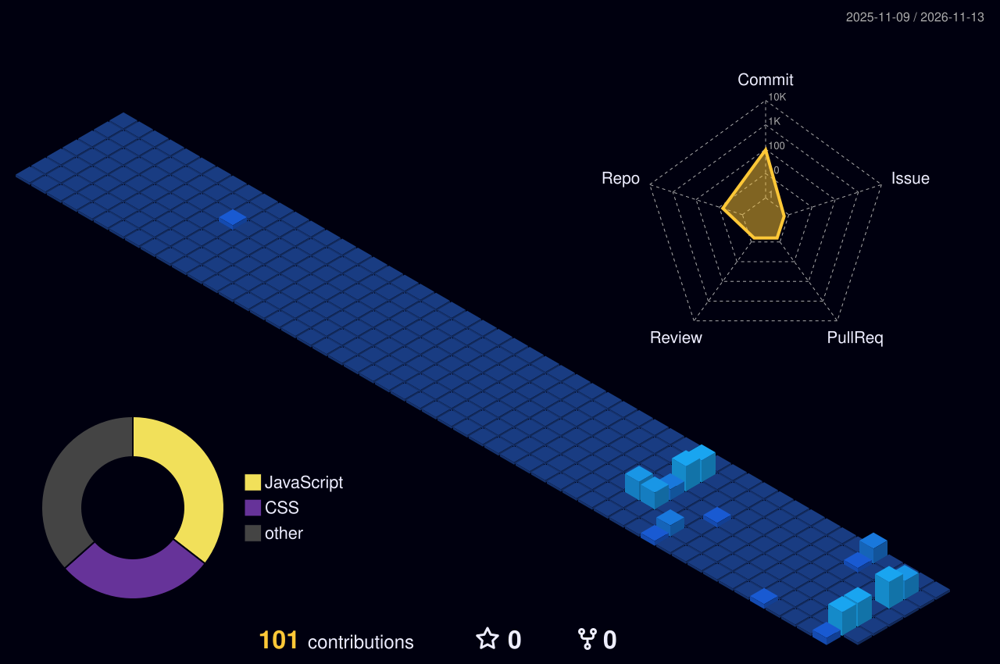

<!-- ====================================================== -->
<!--              VIJAY SAI MALLA - README                  -->
<!--                 PREMIUM EDITION                        -->
<!-- ====================================================== -->

 

 

 

 

---

## 👨‍💻 ABOUT ME

Hey there! I'm **Vijay Sai Malla** 👋

I'm a passionate developer who loves building modern web applications, exploring new technologies, and turning ideas into useful digital experiences.

- 💻 Passionate about **Web Development**
- 🌐 Interested in **Frontend & Full-Stack Development**
- 💡 Programming with **C, C++ & Java**
- ⚛️ Currently learning **React.js**
- 🟢 Exploring **Node.js & Backend Development**
- 🌿 Learning the **MERN Stack**
- 📊 Interested in **Power BI & Data Visualization**
- 🎨 Learning **UI/UX Design**
- 🎬 Experienced with **Video Editing**
- 🚀 Passionate about building **real-world projects**
- 🌱 Continuously learning new technologies

 

---

<h2>◈ THE DEVELOPER ARSENAL</h2>

CRAFTING DIGITAL EXPERIENCES WITH MODERN TECHNOLOGIES

 

<h3>⌘ &nbsp; PROGRAMMING LANGUAGES</h3>

CORE LOGIC • PROBLEM SOLVING

<h3>◈ &nbsp; FRONTEND ENGINEERING</h3>

INTERFACES • INTERACTION • EXPERIENCE

<h3>⚙ &nbsp; BACKEND & DATABASE</h3>

SERVER • APIs • DATA MANAGEMENT

<h3>⌘ &nbsp; DEVELOPER TOOLS</h3>

BUILD • DEBUG • DEPLOY

<h3>✧ &nbsp; DESIGN & DATA VISUALIZATION</h3>

CREATIVITY • VISUAL INTELLIGENCE

 

✦ LEARN · CREATE · INNOVATE ✦

## 🌱 CURRENTLY LEARNING

**My Learning Roadmap:**

- ⚛️ **React.js** — Components, Hooks, Routing & State Management
- 🟢 **Node.js** — Server-side JavaScript
- ⚙️ **Express.js** — Backend APIs
- 🍃 **MongoDB** — NoSQL Database
- 🔌 **REST APIs** — Frontend and backend integration
- 🌐 **MERN Stack** — MongoDB, Express, React & Node.js
- 🏗️ Building complete **Full-Stack Applications**

---

## 🚀 PROJECTS & CREATIONS

I enjoy transforming what I learn into practical projects.

**Areas I love working on:**

| Area | Focus |
|:---|:---|
| 🌐 Web Development | Modern Websites |
| ⚛️ React.js | Interactive Applications |
| 🌿 MERN Stack | Full-Stack Applications |
| ☕ Java | Programming & Logic |
| 📊 Power BI | Data Visualization |
| 🎨 UI/UX | Creative Interfaces |
| 🧩 Problem Solving | Logical Thinking |

> 🚀 More exciting projects are coming soon!

---

## 📊 GITHUB ANALYTICS

  

---

## 🌌 3D CONTRIBUTION GRAPH

---

## 🎯 GOALS & VISION

- 🚀 Become a professional **Full-Stack Developer**
- ⚛️ Master **React.js**
- 🟢 Strengthen **Node.js & Backend Development**
- 🌿 Master the **MERN Stack**
- 🧠 Improve **Problem Solving & Programming**
- ☕ Strengthen **Java** skills
- 📊 Build interactive **Power BI Dashboards**
- 🎨 Improve **UI/UX Design** skills
- 🌍 Contribute to **Open Source**
- 🏗️ Build **production-ready applications**
- 🤝 Collaborate with talented developers
- 💼 Prepare for professional software development opportunities

---

## 💡 WHAT I ENJOY

  

### Learn → Build → Experiment → Improve → Repeat 🚀

---

## 🤝 OPEN TO COLLABORATION

I'm interested in collaborating on:

- 🌐 Web Development Projects
- ⚛️ React Projects
- 🌿 MERN Stack Projects
- ☕ Java Projects
- 📊 Data Visualization Projects
- 🎨 UI/UX Projects
- 🌍 Open Source Contributions

If you're working on something interesting, feel free to connect with me!

---

## 📫 CONNECT WITH ME

---

### 👀 PROFILE VISITORS

  

 

**✦ Transforming Ideas Into Powerful Digital Experiences ✦**

Thanks for visiting my GitHub profile! 😊

